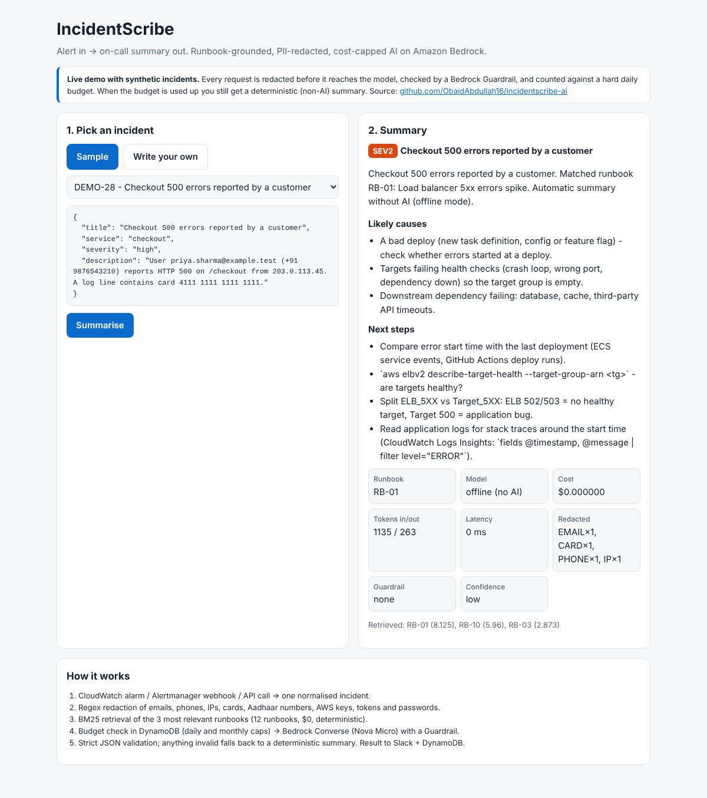
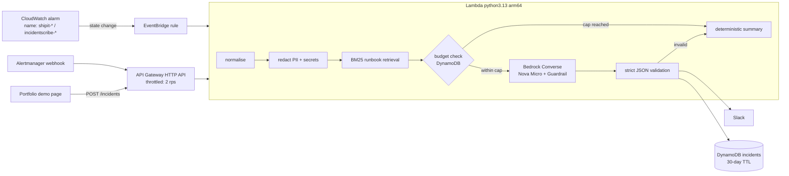

# IncidentScribe AI

[](https://github.com/ObaidAbdullah16/incidentscribe-ai/actions/workflows/ci.yml)

> **Synthetic incidents only.** The demo samples and the 30-case evaluation set are invented for this project.

An AIOps assistant for on-call engineers: a CloudWatch alarm, an Alertmanager webhook or an API call goes in,
and a short, runbook-grounded summary comes out in Slack: severity, likely causes, next steps and the runbook to open.
It is built the way I would build AI features for a client: **personal data is removed before the model sees it,
there is a guardrail around the model, and spend has a hard cap** (about $5 a month).



## Architecture



| Layer | Choice | Why |
|---|---|---|
| Model | Amazon Nova Micro via the `apac.` cross-region profile | ~$0.04 / $0.15 per million tokens; reachable from ap-southeast-2 (Sydney) and ap-south-1 |
| Safety | Regex redaction first, then a Bedrock Guardrail (prompt-attack filter + PII masking) | The code layer is free, testable and runs before any data leaves the function |
| Retrieval | BM25 over 12 runbooks in memory | Deterministic, $0. A managed vector store has a monthly minimum far above the $5 budget |
| Cost control | DynamoDB counters: $0.15/day and $4.50/month caps, checked *before* each call with a worst-case estimate | When the cap is hit, users still get a free fallback summary |
| Robustness | Strict JSON schema; invalid or blocked answers fall back | A bad model answer never breaks the alert path |
| Abuse | API throttling, 8 KB body limit, no Slack posts from the public endpoint | The demo is public by design |

## Evaluation (30 synthetic incidents)

`python evals/run_eval.py` - runs in CI on every push and fails the build if quality drops:

| Metric | Result |
|---|---|
| Runbook retrieval, top 1 | 0.967 (29/30) |
| Runbook retrieval, top 3 | 1.0 |
| PII/secret redaction recall | 1.0 (emails, phones, IPs, cards, AWS keys, passwords, credentials in URLs) |
| Raw PII reaching the prompt | 0 cases |
| False-positive redactions | 0 cases |

Full table: [evals/results/offline.md](evals/results/offline.md). `--live` adds model-side metrics (valid JSON,
runbook match, severity in range, prompt-injection resisted) for a few cents; run it from **Actions > Control > live-eval**.

**Limits, stated honestly:** I wrote the runbooks and the incidents, so these numbers catch regressions; they are
not a measure of real-world accuracy. The next step would be replaying real (redacted) alerts from ShipIt and the SRE lab.

## Run it

```bash
pip install -e ".[dev]"
pytest -q                                   # 31 tests, no AWS needed
MODEL_ID=offline python3 scripts/local-api.py   # local API -> open demo/index.html?api=http://localhost:8787

# AWS (after aws-foundation): idle cost ~$0
bash scripts/up.sh                          # build reproducible zip + terraform apply, prints the API URL
bash scripts/invoke-demo.sh DEMO-28         # PII example through the live API
bash scripts/set-slack-webhook.sh https://hooks.slack.com/services/...   # optional
bash scripts/send-test-alarm.sh             # force the demo alarm -> EventBridge -> Lambda -> Slack
bash scripts/down.sh                        # keeps only your Slack webhook in SSM (free) for the next up
bash scripts/down.sh --all                  # deletes that too, plus leftover log groups
```

To restrict the demo API to your portfolio site:
`ALLOWED_ORIGINS='["https://<your-cloudfront-domain>"]' bash scripts/up.sh` (or the repo variable
`INCIDENTSCRIBE_ALLOWED_ORIGINS` for the GitHub workflows).

**Before the first live call:** Amazon Bedrock serverless models are enabled by default in every commercial region
(since October 2025). Nova needs no extra step; Anthropic models would need a one-time usage form.

## GitHub Actions

| Workflow | What it does |
|---|---|
| CI | ruff, 31 tests, offline eval gate, reproducible-zip check, Terraform validate, Checkov, shellcheck |
| Control (start / stop) | one click: `up`, `down`, `status`, `test-alarm`, `live-eval` (OIDC, no keys) |
| Deploy | redeploys on push to `main` when the repo variable `AUTO_DEPLOY` is `true` |

## Repository map

```
src/incidentscribe/   handler, pipeline, redact, rag (BM25), llm (Bedrock + fallback), budget, slack, runbooks/, samples.json
evals/                incidents.jsonl (30 cases), run_eval.py, results/
infra/terraform/      Lambda, HTTP API, EventBridge rule, demo alarm, DynamoDB, SSM, Bedrock Guardrail
demo/index.html       static demo page (hosted on the portfolio site)
scripts/              build, up, down, status, invoke-demo, send-test-alarm, set-slack-webhook, local-api
```

MIT licensed.
